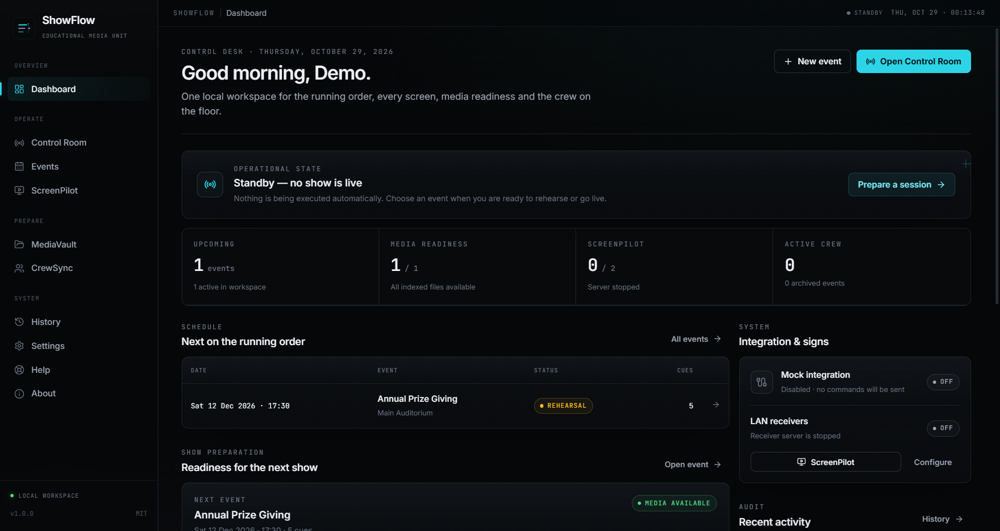
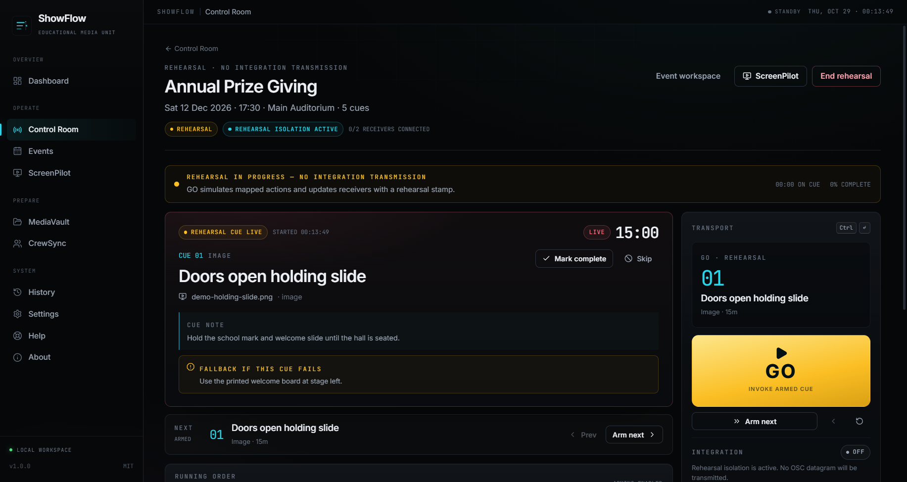
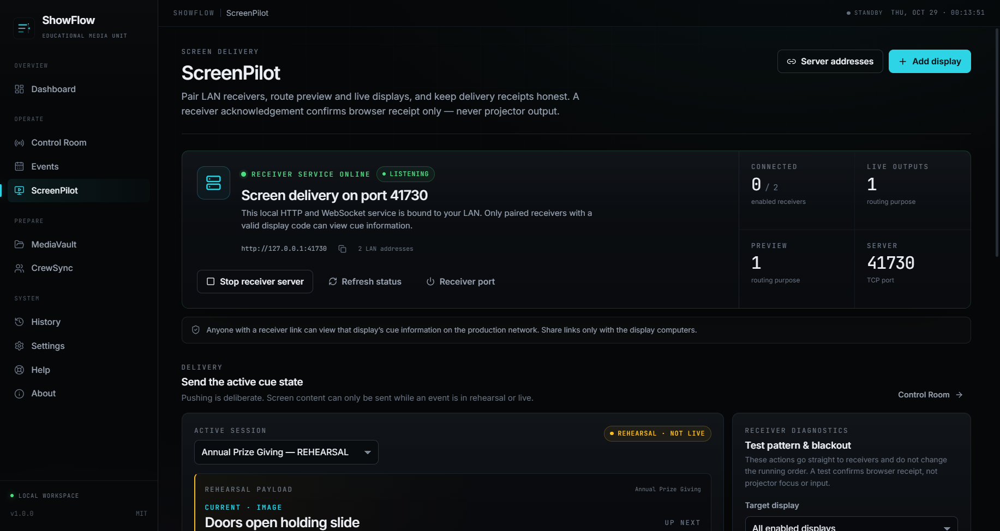
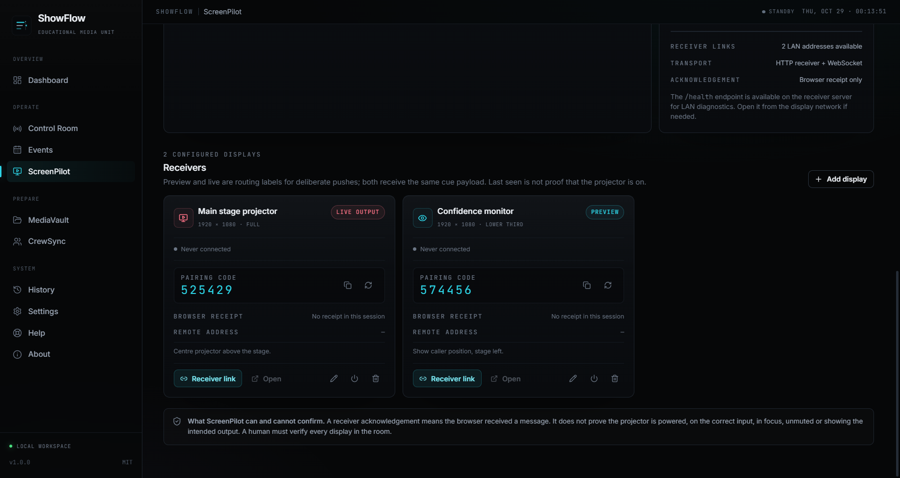

# ShowFlow

**Every cue. Every screen. Every show.**

ShowFlow is an offline-first Windows production control desk for the Educational
Media Unit at Maris Stella College, Negombo. It brings a running order, cue
execution, LAN screen delivery, media readiness, crew planning, and recovery
records into one local desktop application.

It is deliberately not an autonomous show system. The operator remains the show
caller. ShowFlow records what was requested, what was received by software, and
what it cannot possibly verify — and it never pretends to know more.

- **Platform:** Windows 10/11 x64
- **Version:** 1.0.0
- **Storage:** local SQLite (sql.js), no cloud account
- **Network:** off by default; LAN receiver starts manually
- **Telemetry:** none
- **Licence:** MIT

> **Project status:** source-complete and locally verified. No binary has been
> published from this workspace, no remote repository is configured, builds are
> unsigned, and the GitHub workflows have not executed. See
> [Verification](#verification) and [Known limitations](#known-limitations).

## Why ShowFlow

Most production software is optimized for what it can do. ShowFlow is optimized
for telling the operator what it actually knows.

- **No automatic execution.** Launching the app starts no cue, no session, and
  no receiver server. There is no autoplay path.
- **No replay after a crash or restart.** A live or rehearsal event is recovered
  as `interrupted`; every cue must be invoked again.
- **Honest delivery state.** A receiver acknowledgement confirms a browser
  received a message. It does not confirm projector power, input, focus, or that
  an audience saw anything. A Resolume OSC send is reported as unverified.
- **Rehearsal is isolated.** Rehearsal moves the running order and screen
  previews but never transmits integration commands.
- **Live is a deliberate gate.** OSC sends require a `live` event, an enabled
  integration, and a mapped cue. Archived and completed events cannot transmit.
- **The room is the source of truth.** Test patterns, blackout, and visual checks
  exist because software cannot see the projection.

## Modules

| Module | What it does |
| --- | --- |
| **Dashboard** | Next event, readiness warnings, current integration/display state, and recent activity. |
| **Events** | Create, filter, duplicate, archive, and delete events; build a running order; export run sheets and event plans. |
| **Control Room** | Rehearse or run an event: arm, GO, complete, skip, timers, notes, screen push, and emergency blackout/interrupt. |
| **ScreenPilot** | Register displays, start/stop the LAN receiver, pair browsers, copy links, monitor health, send test patterns, and black out receivers. |
| **MediaVault** | Index files and folders, record metadata, detect missing files, relink by file or folder, and export the library index. |
| **CrewSync** | Maintain a local crew roster, assign roles to events, and track setup/shutdown checklists. |
| **History** | Search the local activity trail and record production notes. |
| **Settings** | Operator/venue, receiver port, Resolume OSC configuration, backups, integrity checks, and data-folder access. |
| **Help / About** | The operator handbook, safety boundaries, diagnostics, and build information. |

## Screenshots

Captured from the built application with temporary, fictional demo data.

| Dashboard | Control Room |
| --- | --- |
|  |  |
| **ScreenPilot** | **ScreenPilot receiver management** |
|  |  |

## Install

Two Windows x64 build types are produced by `npm run dist`:

- `release/ShowFlow-1.0.0-Windows-Setup.exe` — per-user NSIS installer. It asks
  for an install location, creates Start Menu and desktop shortcuts, and does not
  request elevation.
- `release/ShowFlow-1.0.0-Windows-Portable.exe` — portable executable. It unpacks
  to a temporary directory at launch.

The builds are currently **unsigned**. Windows SmartScreen may warn. Only run a
build from a trusted source and verify `SHA256SUMS.txt`:

```powershell
npm run checksums -- --verify
```

No download link or published release is claimed here. Build from source or use
a build provided directly by the maintainer.

### User data

Both build types use Electron's normal user-data directory:

```text
%APPDATA%\ShowFlow\
  showflow.db
  showflow.db.bak
  backups\
  logs\showflow.log
```

The uninstaller intentionally preserves this folder. Uninstalling ShowFlow
removes the application and shortcuts, not your productions, backups, or logs.
Delete the folder manually only when you are certain you no longer need the data.

The portable build also uses `%APPDATA%\ShowFlow`, so it shares data with an
installed copy.

## First show

1. Complete onboarding with your operator name and default venue.
2. Create an event with its date, venue, and production notes.
3. Build the running order: cue type, duration, operator, fallback instruction,
   and optional media asset.
4. Index source media in MediaVault and resolve missing-file warnings.
5. Add crew and event assignments in CrewSync; finish the setup checklist.
6. Register displays in ScreenPilot. Start the receiver server only when the
   display network is ready, then open each receiver link on its display browser.
7. Rehearse in the Control Room. Confirm screen content, projector input, focus,
   audio, and playback software visually.
8. Start a live session only when the room is ready. Arm a cue and press **GO**
   (`Ctrl+Enter`) at the moment.
9. End the session deliberately. Ending does not switch off external equipment.

The complete operator guidance is in [docs/USER-GUIDE.md](docs/USER-GUIDE.md) and
inside the app under **Help**.

## Architecture

```text
┌──────────────────────────── ShowFlow ────────────────────────────┐
│ React renderer (sandboxed)                                       │
│   │ frozen preload API + validated IPC                            │
│ Electron main process                                            │
│   ├── sql.js SQLite database (userData)                           │
│   ├── MediaVault service + showflow-media:// protocol             │
│   ├── ScreenPilot HTTP/WebSocket receiver server (manual start)   │
│   └── Integration service (mock + Resolume OSC over UDP)          │
└──────────────────────────────────────────────────────────────────┘
        │ LAN HTTP/WS (optional)          │ UDP OSC (optional, live only)
   Browser receivers                 Resolume
```

The renderer has no Node.js access. The main process owns the database, file
dialogs, media index, network listener, and every production command. See
[docs/ARCHITECTURE.md](docs/ARCHITECTURE.md) for state machines, IPC, schema, and
recovery details.

## Development

Requirements: Windows 10/11 x64, Node.js 24 LTS (22.12+ supported), npm 11+.

```powershell
npm ci
npm run icons
npm run dev
```

Useful scripts:

| Command | Purpose |
| --- | --- |
| `npm run dev` | Vite + Electron with hot reload |
| `npm start` | Launch Electron against the existing renderer build |
| `npm run build:renderer` | Production Vite build |
| `npm run lint` | ESLint |
| `npm test` | Vitest unit/integration suite |
| `npm run test:e2e` | Build renderer, then run the source Electron smoke test |
| `npm run dist` | Build NSIS installer, portable executable, and unpacked app |
| `npm run test:e2e:packaged` | Smoke-test `release/win-unpacked/ShowFlow.exe` |
| `npm run icons` | Regenerate PNG/ICO/installer artwork from `build/icon-source.svg` |
| `npm run checksums` | Write `release/SHA256SUMS.txt` |
| `npm run checksums -- --verify` | Verify existing checksums |
| `npm run screenshots` | Capture documentation screenshots with temporary demo data |

E2E tests use temporary user-data directories and `SHOWFLOW_E2E=1`. They do not
touch real production data.

## Data and recovery

- The database is written atomically through a temporary file and rename.
- A previous-launch copy is kept as `showflow.db.bak`; an unreadable primary is
  preserved as `showflow.db.corrupt-<timestamp>` before recovery.
- Automatic backups run at most once every 20 hours when enabled, retain 3–30
  copies (default 8), and never prune manual backups.
- Restore validates format, schema, row counts, and checksum, creates a safety
  backup first, then requires an interface reload.
- A backup contains database content only. It does not contain original media,
  logs, or external show files.

## Integration boundaries

Only two Resolume OSC operations are implemented, both taken from Resolume's OSC
documentation:

| Action | OSC address | Argument | Feedback |
| --- | --- | --- | --- |
| Connect clip | `/composition/layers/{layer}/clips/{clip}/connect` | `int 1` | None |
| Set layer opacity | `/composition/layers/{layer}/video/opacity` | `float 0..1` | None |

OSC is one-way UDP. ShowFlow never reports these sends as acknowledged. The
built-in test verifies target resolution and the local UDP socket only; it sends
no datagram. Mock mode simulates actions without contacting any equipment.

See [docs/INTEGRATIONS.md](docs/INTEGRATIONS.md) for setup, capability limits, and
what is deliberately unsupported.

## Security

Security controls include renderer sandboxing, context isolation, a frozen
preload bridge, a strict IPC allowlist, validated inputs, navigation and
permission blocking, CSP, a restricted media protocol, per-display receiver
pairing, rate limiting, and a single-instance lock.

The receiver uses plain HTTP/WebSocket on a trusted production LAN. Receiver
links are bearer credentials. There is no TLS mode. The application stores data
unencrypted at rest, has no telemetry, and does not auto-update.

Read [SECURITY.md](SECURITY.md) before deploying ShowFlow on a shared network.

## Verification

The following gates were run locally on Windows 11 x64 with Node.js 24.22.1 on
2026-10-29:

| Check | Result |
| --- | --- |
| `npm run lint` | Passed, 0 errors and 0 warnings |
| `npm test` | Passed, 9 files / 83 tests |
| `npm run build:renderer` | Passed |
| `npm run test:e2e` | Passed, 15 steps: onboarding, event/cue flow, rehearsal GO, honest simulated state, history, core screens, runtime security, receiver manual start/health/stop, persistence, restart recovery, no replayed commands |
| `npm run dist` | Passed: NSIS installer (136,819,573 bytes) and portable executable (119,030,385 bytes) |
| `npm run test:e2e:packaged` | Passed against `release/win-unpacked/ShowFlow.exe` |
| Application icon extraction | Passed: installer and executable icons match `build/icon.png` (mean channel difference 0.77) |
| Silent install / launch / uninstall | Passed with temporary install and data paths: install directory and desktop shortcut removed, database retained; real `%APPDATA%\ShowFlow` untouched |
| `npm run checksums -- --verify` | Passed for Setup and Portable executables |
| `npm audit` | 0 vulnerabilities at build time |

Not verified:

- Real Resolume software or hardware. OSC paths are unit-tested and documented;
  no production Resolume instance was available.
- Real projector, audio, lighting, or media-player behavior.
- Code signing or SmartScreen reputation.
- GitHub Actions execution or release publishing, because no remote repository
  is configured.
- macOS or Linux packaging.
- A formal accessibility audit, screen-reader testing, or long-duration soak
  testing.

See [docs/VERIFICATION.md](docs/VERIFICATION.md) for the detailed evidence record.

## Known limitations

- Windows x64 only.
- Builds are unsigned; no code-signing certificate is configured.
- No auto-update, cloud sync, or remote collaboration.
- Receiver output is browser-based. It cannot control projector power or input.
- Receiver HTTP/WS is unencrypted and relies on LAN trust plus pairing codes.
- Only the two documented Resolume operations are supported. No transport
  feedback, clip disconnect, or general OSC mapping.
- SQLite and backups are not encrypted at rest.
- The current environment has no Git remote or published release; repository
  URLs in `package.json` are intentionally empty.

## Documentation

- [Architecture](docs/ARCHITECTURE.md)
- [Operator guide](docs/USER-GUIDE.md)
- [Resolume integration](docs/INTEGRATIONS.md)
- [Troubleshooting](docs/TROUBLESHOOTING.md)
- [Release process](docs/RELEASE.md)
- [Verification record](docs/VERIFICATION.md)
- [Contributing](CONTRIBUTING.md)
- [Security](SECURITY.md)
- [Changelog](CHANGELOG.md)

## Institutional note

ShowFlow was built for the Educational Media Unit at Maris Stella College,
Negombo, Sri Lanka. The institutional affiliation identifies the intended media
unit. ShowFlow is an independent project and is not an official school
publication or endorsement unless separately confirmed.

## Licence

Copyright © 2026 Sandila Fernando. Released under the [MIT License](LICENSE).
